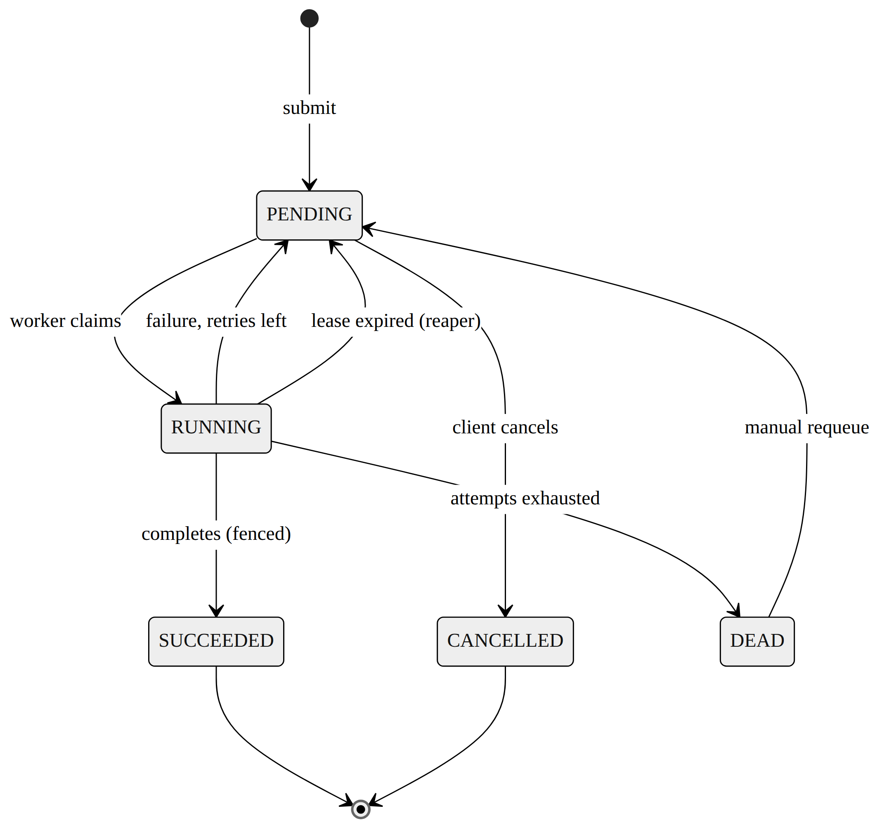

# Distributed Job Processing System

Requirements and Design Specification

**Status**  Draft v0.2

**Purpose**  Portfolio project in distributed systems engineering

**Focus**  Reliability, concurrency, failure recovery, retries, idempotency and worker coordination

**Contents**

0. Glossary

1. Problem Statement

2. Functional Requirements

3. Initial API

4. Job State Machine

5. Guarantees

6. What Is Not Guaranteed

7. Failure Model

8. Initial Parameters

9. Performance Hypotheses

10. Assumptions

11. Open Questions

12. Architecture Decisions

13. Success Criteria for Phase 0

## 0. Glossary

| Term | Meaning |
|---|---|
| Lease | A time-limited claim a worker holds on a job. If the worker doesn't renew it before it runs out, the job counts as abandoned. |
| Fencing | A check attached to every state-changing write that confirms the writer still owns the current lease and attempt. It stops a stale worker from overwriting newer state. |
| At-least-once execution | A job runs one or more times. Never zero, but possibly more than once. |
| Idempotency key | A token the client sends so that repeating a submission is safe. A repeat gets the original job back instead of creating a new one. |
| Reaper | A background process that looks for jobs with expired leases and makes them claimable again. |

## 1. Problem Statement

### 1.1 What the system is

This is a small distributed job processing system. Trusted clients submit asynchronous jobs through a REST API. The API writes each accepted job to PostgreSQL, and a pool of independent workers claims those jobs and runs them.

Workers will fail, and the system has to keep going when they do. Leases, heartbeats, retries and a recovery process (the reaper) work together to spot abandoned work and hand it to another worker.

So the hard part isn't running jobs. It's coordinating a group of unreliable workers while still being able to say exactly what happens to a job: when it becomes durable, how many times it can run, how it recovers, and which state changes are allowed.

Two things are ruled out from the start. Execution is **at-least-once**, not exactly-once. And there is **no ordering guarantee** between independent jobs.

This is an engineering experiment, not a production-ready job platform.

### 1.2 Who submits jobs

Trusted programs over HTTP. For example:

- command-line clients
- test scripts
- load generators
- other internal services

As soon as a job is accepted, the client gets a job ID back. It doesn't wait for the job to run.

Clients will retry when a request times out, so the API accepts an optional idempotency key. With a key, a client can resend a submission without accidentally creating duplicate jobs.

Authentication, authorization, quotas and multi-tenancy are out of scope.

### 1.3 What a job is

A job is an independent, asynchronous unit of work. Each one has these fields:

| Field            | Description |
|------------------|---|
| id               | Unique ID generated by the system |
| type             | Handler type: CPU, IO or FLAKY |
| payload          | Small JSON input for the handler |
| idempotency_key  | Optional key supplied by the client |
| status           | Lifecycle state: PENDING, RUNNING, SUCCEEDED, DEAD, CANCELLED |
| attempts         | How many execution attempts have happened so far |
| max_attempts     | The most attempts allowed |
| result           | Output of a successful run |
| last_error       | The most recent failure |
| locked_by        | Worker currently holding the lease |
| lease_expires_at | When that worker's lease runs out |
| generation            |   starts at 0, incremented by manual requeue; fencing and handler identity use (generation, attempt)          |

**Attempt numbering.** attempts starts at 0 and goes up by one, atomically, at the moment a worker claims the job. The first run is therefore attempt 1. Fencing checks always compare against the attempt number the worker captured when it claimed the job, not the current value in the column. That's how a stale worker gets caught (see G5 in Section 5).

Starting constraints:

- Jobs are independent. No dependency graph, no required order.
- Most jobs finish within a few seconds, a few minutes at most.
- Payloads are capped at about 64 KB. Anything larger is passed by reference, not embedded.
- Because delivery is at-least-once, a job can run more than once. Handlers have to cope with that.

Every run receives the stable job ID and the attempt number. A handler that needs to detect repeats can use them, for example by checking (job_id, attempt) against its own log of side effects.

### 1.4 Built-in job types

There are three deterministic job types, built for experiments.

| Type | Behaviour | Main experiment |
|---|---|---|
| CPU | Does a configurable amount of CPU-heavy work | Worker scaling and throughput |
| IO | Sleeps for a configurable duration | Concurrency and throughput |
| FLAKY | Fails based on configurable behaviour or probability | Retries, backoff and dead jobs |

With these, the same infrastructure can be pushed through very different workloads without ever running arbitrary user code.

### 1.5 Out of scope

| Feature | Why it's left out |
|---|---|
| Authentication / authorization | Not central to the distributed systems problem |
| Multi-tenancy | Brings in isolation and quota complexity |
| Job priorities | Would need scheduling and fairness policies |
| Fairness between job types | Not needed for the core experiments |
| Job dependencies / DAGs | That's workflow orchestration, a separate problem |
| Exactly-once execution | The system deliberately provides at-least-once |
| Multi-region deployment | Doesn't fit a single-node database design |
| PostgreSQL high availability | PostgreSQL stays a known single point of failure |
| Web dashboard | The API, logs and metrics are enough |
| Cron / scheduled jobs | Jobs are always submitted explicitly |
| Arbitrary user code | Only the predefined handlers can run |

## 2. Functional Requirements

### 2.1 Job submission

**FR-1 Submit a job.** A trusted client can submit a job through the REST API. On success it gets a unique job ID back straight away, without waiting for execution.

**FR-2 Validate the submission.** The system rejects a submission if it has:

- an unsupported job type
- an invalid payload
- a payload over the configured size limit
- a max_attempts override outside the allowed range (for example 1 to 10)

max_attempts has a system-wide default (Section 8). A client can override it per job, but only inside the allowed range.

**FR-3 Persist before acknowledging.** The API writes the job to PostgreSQL before it returns success. A success response means the job is durably stored, not just sitting in application memory.

### 2.2 Idempotent submission

**FR-4 Optional idempotency key.** A client can send an idempotency key in the `Idempotency-Key` HTTP header when submitting a job.

**FR-5 Same key, same payload.** The system returns the job it already created instead of making a second one. This holds whatever state that job is in, including SUCCEEDED, DEAD or CANCELLED. A repeat never triggers another run. It only returns the existing job as it currently stands.

**FR-6 Same key, different payload.** The request is rejected with a conflict response. The new payload is never quietly attached to the existing job.

### 2.3 Job status and results

**FR-7 Query a job.** Clients can fetch the current state of a job through the API.

**FR-8 What the response contains.** Job ID, type, status, attempts, max attempts, result (if there is one) and the most recent error (if there is one). Lease details can be exposed on an admin or debugging endpoint. Normal clients don't need them.

### 2.4 Job listing

**FR-9 List jobs.** Clients can list jobs.

**FR-10 Filter and paginate.** Jobs can be filtered by status (PENDING, RUNNING, SUCCEEDED, DEAD, CANCELLED). Pagination is **cursor-based on** **id**, not offset-based. Offset pagination breaks on a table where rows keep changing status: jobs move around between two page requests, so you get skipped or duplicated rows.

### 2.5 Cancellation

**FR-11 Cancel a pending job.** A client can cancel a job that hasn't started. A successful cancel moves it PENDING → CANCELLED.

**FR-12 Running jobs can't be cancelled (for now).** The first version rejects cancellation of a RUNNING job with a conflict response. Cooperative cancellation would complicate the worker protocol, and it isn't worth it in v1.

**FR-13 Terminal jobs.** A job that is SUCCEEDED, DEAD or CANCELLED can't be cancelled.

### 2.6 Worker execution

**FR-14 Worker identity.** Each worker has a unique ID, which it uses when claiming and processing jobs.

**FR-15 Claiming jobs.** Workers claim available PENDING jobs atomically. Many workers can compete for jobs, but no two can process the same attempt at the same time.

**FR-16 Execution lease.** When a worker claims a job it gets a time-limited lease that records the worker ID, job ID, attempt number and expiry time.

**FR-17 Heartbeat.** A worker running a long job renews its lease periodically. Renewal is a fenced write too (Section 4). Once another worker has legitimately picked up the expired job, the old worker can't renew.

### 2.7 Successful execution

**FR-18 Completing a job.** When a job finishes successfully, the worker tries to move it RUNNING → SUCCEEDED. The update checks that the worker still owns that attempt (fencing).

**FR-19 Storing the result.** The result is saved on the job. Because of fencing (FR-26, G5), a stale worker can't overwrite a result from a newer attempt.

### 2.8 Failure and retry

**FR-20 Detecting failure.** The worker records a failure when a handler raises an expected job failure.

**FR-21 Automatic retry.** If attempts remain, the job becomes eligible to run again after the configured backoff: RUNNING → PENDING.

**FR-22 Retry limit.** A job never goes past its maximum attempts.

**FR-23 Dead jobs.** Once a job has used up its attempts it moves to DEAD and won't run again automatically.

### 2.9 Worker failure and recovery

**FR-24 Detecting abandoned jobs.** The system finds jobs whose lease has expired.

**FR-25 Requeuing abandoned jobs.** If a worker dies or goes quiet and its lease expires, the job becomes eligible for another attempt.

**FR-26 Protection against stale workers.** A worker that has lost its lease can't change the job's state or result using its old attempt. Every state-changing operation is fenced, heartbeat renewal included (FR-17).

### 2.10 Manually requeuing a dead job

**FR-27 Requeue a dead job.** An admin operation can put a DEAD job back in the queue. It resets attempts to 0 so the job gets a fresh budget, and it keeps every earlier `job_attempts` row for debugging. The requeue is written as its own flagged history entry, with `attempt = 0` and `outcome = 'MANUAL_REQUEUE'`, so it's easy to tell apart from an automatic retry. This is not part of normal retry behaviour.
## 3. Initial API

| Method | Endpoint                        | Purpose |
|---|---------------------------------|---|
| POST | /api/jobs                       | Submit a job |
| GET | /api/jobs/{id}                  | Fetch a job |
| GET | /api/jobs?status=PENDING&cursor=... | List and filter jobs (cursor pagination) |
| POST | /api/jobs/{id}/cancel               | Cancel a pending job |
| POST | /api/jobs/{id}/requeue              | Manually requeue a dead job |

The worker protocol is internal for now, not a public REST API. Workers talk to the job store directly through the worker service.

## 4. Job State Machine



Job lifecycle and the transitions between states.

There's no separate REQUEUED status. A recovered job goes straight back to PENDING. You can only tell it was recovered, rather than freshly submitted, from the job_attempts history and the attempts counter. It never shows up in status.

### Transition rules

| Transition | Triggered by | Guard |
|---|---|---|
| PENDING → RUNNING | Worker | Job is claimable (status='PENDING' AND run_at<=now(), SKIP LOCKED) |
| RUNNING → SUCCEEDED | Worker | Worker owns the current lease and attempt |
| RUNNING → PENDING | Worker | Current attempt failed and retries remain |
| RUNNING → PENDING | Reaper | Lease expired and retries remain |
| RUNNING → DEAD | Worker / reaper | Max attempts used up |
| PENDING → CANCELLED | Client | Job hasn't been claimed |
| DEAD → PENDING | Admin | Explicit requeue, resets attempts to 0 |
| terminal → anything | Anyone | Rejected unless allowed above |

The rule behind all of this: a worker never gets to simply declare "this is my job." PostgreSQL checks ownership on every write.

```sql
UPDATE jobs
SET status = 'SUCCEEDED',
    result = :result
WHERE id = :job_id
  AND status = 'RUNNING'
  AND locked_by = :worker_id
  AND attempts = :attempt_at_claim_time
  AND generation = :generation;
  
  
```

## 5. Guarantees

**G1 Durable acceptance.** Once POST /api/jobs returns success, the job survives a crash of any API instance or worker, because it's already in PostgreSQL.

**G2 At-least-once execution.** Every accepted job runs at least once, unless it's cancelled or ends up DEAD. It may run more than once.

**G3 Bounded recovery.** If a worker dies while holding a job, the job becomes eligible for another attempt within roughly lease duration + reaper interval. Database or network outages aren't counted.

**G4 Idempotent submission.** Concurrent submissions with the same idempotency key and equivalent payloads produce exactly one job.

**G5 No stale writes.** A worker that has lost ownership of a job can't overwrite the state or result of a newer attempt. This is the main fencing guarantee of the project.

**G6 Bounded retries.** Automatic retries never take a job past its max attempts. After that it's DEAD.

## 6. What Is Not Guaranteed

- exactly-once execution
- global ordering of jobs
- fairness between job types
- availability while PostgreSQL is down
- recovery from permanent PostgreSQL data loss
- protection against malicious clients
- multi-region availability

These are deliberate design choices, not gaps.

## 7. Failure Model

| Failure | In scope? | What should happen |
|---|---|---|
| Worker killed with SIGKILL | Yes | Lease expires and the job is recovered |
| Worker freezes (GC pause / SIGSTOP) | Yes | Lease eventually expires. If the worker wakes up and tries to write, fencing rejects it |
| Worker crashes **after** the handler finishes but **before** the fenced SUCCEEDED update commits | Yes | Another worker runs the job again. This is exactly the case that makes idempotent handlers (Section 1.3) necessary |
| API instance crashes | Yes | Stored jobs stay available through other instances |
| PostgreSQL briefly unavailable | Yes | API returns an error. Workers back off and retry the connection |
| Redis unavailable | Later version | PostgreSQL remains the source of truth |
| Network delay between worker and DB | Yes | Lease and heartbeat behaviour is tested directly |
| PostgreSQL disk permanently destroyed | No | Out of scope |
| Malicious worker or client | No | The environment is assumed trusted |
| Whole machine fails | Partly | Recovery depends on the database being available |

## 8. Initial Parameters

| Parameter | Starting value |
|---|---|
| Lease duration | 30 seconds |
| Heartbeat interval | 10 seconds |
| Reaper interval | 5 seconds |
| Default max automatic attempts | 5 |
| Allowed client max_attempts range | 1 to 10 |
| Retry backoff base | 2 seconds |
| Backoff maximum | 60 seconds |
| Backoff shape | Exponential with jitter |
| Worker claim batch size | 10 |
| Maximum payload | about 64 KB |

These are starting points. They'll change once the load and failure experiments have run.

## 9. Performance Hypotheses

These are guesses to test, not promises:

- Submission p95 under 50 ms at around 200 requests per second, in a controlled local environment.
- Four workers handling at least 500 lightweight (near no-op) jobs per second in a controlled benchmark.
- A worker killed mid-job leads to recovery in about 40 seconds with the initial lease and reaper settings.
- Adding workers improves throughput for CPU and IO workloads until some other bottleneck takes over.

The Phase 5 experiments will show which of these hold up.

## 10. Assumptions

1. PostgreSQL commits are durable.
2. PostgreSQL is the authoritative source of job state.
3. Lease expiry is checked with PostgreSQL's now(), not worker clocks. Correctness doesn't depend on worker clocks being in sync. (This settles what used to be Open Question 1.)
4. Jobs are independent and short.
5. Clients are trusted.
6. Job handlers are idempotent.
7. The system runs in a single region or environment at first.
8. The database itself isn't highly available.
9. Most evaluation happens in controlled local or containerized experiments.

## 11. Open Questions

1. When a worker loses its PostgreSQL connection, should it retry at a fixed interval or use the same exponential backoff with jitter as job retries?
2. Retryable jobs stay in PENDING with a run_at timestamp (the chosen approach). Need to confirm the reaper and the claim query both honour it the same way.
3. How much job_attempts history should be kept per job before it's archived or pruned?
4. Should result and last_error get their own size limits, separate from the payload limit?
5. At what load does PostgreSQL polling become the bottleneck, and is that the right moment to bring in Redis Streams (Phase 4)?

The old Open Question 1, about which clock to use for lease expiry, is now closed. See Assumption 3.

## 12. Architecture Decisions

### ADR-001: PostgreSQL as the source of truth

- **Decision:** PostgreSQL holds the authoritative job state.
- **Reason:** Durability, transactional state changes, idempotency constraints and fencing can all be built and observed directly in PostgreSQL.
- **Consequence:** PostgreSQL starts out as a single point of failure and may become the bottleneck later.

### ADR-002: PostgreSQL polling before Redis

- **Decision:** The first version claims jobs with PostgreSQL row locking and SKIP LOCKED. Redis Streams comes later and gets benchmarked against this baseline.
- **Reason:** The first version should isolate the correctness problem and show it working before another distributed component is added.
- **Consequence:** PostgreSQL handles both durable storage and job-claim coordination at first.

### ADR-003: At-least-once delivery

- **Decision:** Execution is at-least-once, and handlers must be idempotent.
- **Reason:** You can't honestly claim exactly-once when a handler can finish its work before the worker manages to record that it finished.
- **Consequence:** Duplicate runs can happen and have to be tested on purpose (see Section 7, row 3).

### ADR-004: Manual requeue resets attempts

- **Decision:** Requeuing a DEAD job resets attempts to 0 and increments the generation counter by 1, while logging a dedicated flagged history entry for the event.
- **Reason:** Raising max_attempts on a live job mixes automatic retries and human intervention in the history, which makes debugging harder and makes the retry guarantee (G6) harder to reason about.
- **Consequence:** A manually requeued job's history covers two "generations." You can only tell them apart by the flagged entry, not from attempts alone.

## 13. Success Criteria for Phase 0

Phase 0 is done when:

- The requirements document is committed.
- Every job state has a clear meaning, and no state appears in a diagram without also being in the data model, or the other way round.
- Every valid transition has an owner and a guard.
- Each of the six guarantees can be turned into an automated test.
- The major failure scenarios have expected behaviour written down.
- The initial parameters are documented.
- The major non-guarantees are stated explicitly.
- All four architecture decisions have ADRs.
- The design can be explained without leaning on anything undocumented.

Implementation doesn't start until all of these are true.
